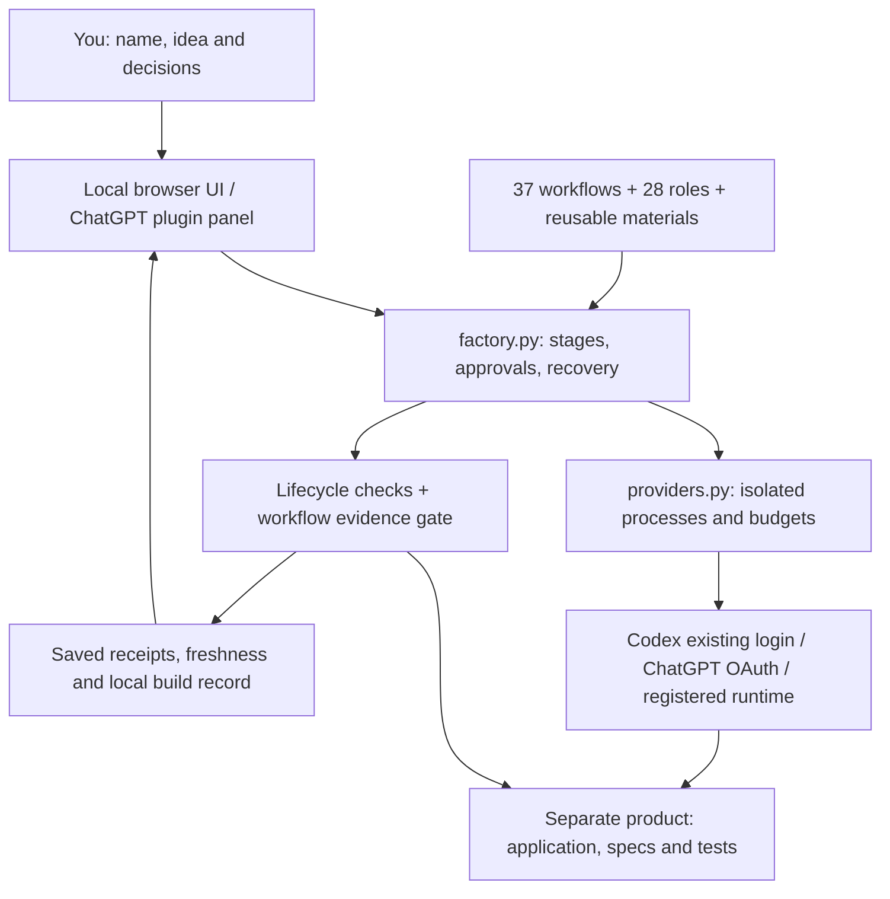

# Foundry

**Your local software factory. Give it a product name and idea, review the important decisions, and build with saved checks.**

Foundry now has a working factory controller, a browser control panel, local MCP
plugin packaging, and an optional **Continue with ChatGPT** connection. It reuses
the existing 37 workflows, 28 specialist roles, 67 optional references, recipes,
hooks, lifecycle and evidence contracts. No global Foundry skill is required.

## Open the factory

From this checkout:

```sh
./foundry
```

The first launch prepares an isolated Python environment and opens
`http://127.0.0.1:8765`. It needs Python 3.11+, Git, and the Codex CLI. Building the
bundled plugin panel additionally needs Node 22+. The UI runs locally on macOS or
Linux; Foundry's new ChatGPT credential storage currently requires macOS Keychain.
The existing Codex login route remains available on supported Codex platforms.

1. Select **New product**, enter its name and idea, then **Create product**.
2. Open **Account & runtime**. Use your existing Codex login, or **Continue with
   ChatGPT** and approve the requested identity and plan-usage permissions in your
   browser. Select **ChatGPT plan** for the product to use that new connection.
3. Leave models blank to inherit your runtime defaults, or choose a coordinator
   model, reasoning effort, and explicit specialist overrides.
4. **Continue with Research** runs research and prepares scope. Open the scope
   document, review it, and **Approve and continue** when it is right.
5. Review the design and approve it. Foundry then builds, independently reviews,
   executes the real configured product checks, and prepares a local release
   handoff. Failed or missing evidence stops progress.
6. Review the product in its own folder. Publication, hosting, account connections,
   service spending, and deployed verification are separate decisions.

Product folders are created automatically under the sibling `products/` folder.
Each product has its own code, Git repository, specs, specialist settings, check
configuration, and evidence. `--products-dir` is an optional override, not a
required setup step. `./foundry --port 8766` selects another local port.

Existing Codex login uses `codex exec`; it must be a working, subscription-backed
local login. Foundry does not inspect or copy Codex credentials. API billing is
not implicitly authorized. On macOS it prefers the desktop app's matching Codex
executable; `FOUNDRY_CODEX` can select another working runtime. The separate ChatGPT route uses the documented OAuth
plan flow and Codex App Server; it is an experimental platform integration.
A live successful sign-in and completed turn are needed to prove account/model
access. Unit tests do not supply the owner's consent.
See [ChatGPT setup and availability](docs/CHATGPT.md).

## What runs under the hood



The Python controller advances stages and verifies artifacts. The selected agent
runtime implements the work and supplies its tools. The factory loop runs until
an owner approval, failure, interruption, or final release handoff. Approvals bind
the exact scope/design document digest; changed decisions require another review.
Model output alone cannot pass verification. Required accepted criteria must map
to real required checks, and the workflow gate must pass against current receipts.

[Architecture and actual source maps](docs/ARCHITECTURE.md) explain the layers.
[Platform research and remaining distribution work](docs/FACTORY-PLAN.md) records
what the latest releases enable and what still needs external qualification.

## Use it as a local plugin

This repository includes `plugin.json`, `mcp.json`, an MCP server, an embedded
panel with global/sidebar and thread entrypoints, and a private repo marketplace
at `.agents/plugins/marketplace.json`. Open this repo in a supported ChatGPT/Codex
client, refresh or restart it, find **Foundry private** in Plugins, and enable
Foundry. The host may ask you to trust the local MCP executable.

The plugin launches the same factory through the official MCP SDK. It keeps its
Python environment and state in the host's writable `PLUGIN_DATA`, and products
under that directory's `products/`. First use installs the pinned declared
runtime dependencies. Local plugin products and standalone products use separate
registries. Owner approvals and account controls are app-only tools; model-facing
tools create, inspect, run, read artifacts, and request cancellation.

This is **private local packaging**, not a published universal-directory plugin.
ChatGPT web cannot directly run this laptop's stdio server. Public distribution
needs an approved HTTPS service, tenant isolation, publisher information, and
OpenAI review. Local MCP protocol and resource delivery have runnable checks;
client installation and actual sidebar rendering must be checked in that client.

## Providers and specialists

The controller's file/state/check contracts are portable. Codex is the supplied
full agent harness. A custom local agent-runtime adapter can be registered in
`.foundry/providers.json` using the existing JSONL contract; creation copies the
validated registration into the product. A plain model endpoint is not enough to
build products: the adapter must supply tools, permissions, and completion events.
No second commercial provider is currently qualified end to end.

Specialist model and reasoning settings are applied to product-local native
agent TOML files. Use **Specialists & settings** instead of editing those files.
Blank means inherit the owner's runtime defaults, including configured specialist
defaults; runtime rejection is shown without switching providers or
models. Availability depends on the installed Codex runtime and selected account.
The ChatGPT plan preview currently disables native multi-agent execution; its
coordinator still uses local tools and relevant role guidance. Use the existing
Codex route when native specialist delegation is required.

Research/scope identify useful services and permission gaps. Foundry never treats
a written integration plan as a connected account. MCP tools available in the
selected agent runtime are the connection boundary; this release does not build
a separate universal account broker. See [provider contracts](docs/PROVIDERS.md).

For an existing product, the lower-level installer remains available:

```sh
python3 scripts/marketcraft.py install /absolute/path/to/product
```

It copies managed workflow material and runtime, preserves product code, and
initializes local Git if needed. It does not itself generate an app, connect a
remote, or install product dependencies. The UI factory provides the orchestration
around that installer. Use `--update` only for an intended framework update;
conflicting local edits stop it.

## Skills and command shortcuts

The current Codex integration exposes project-local workflow instructions as
skills, such as `$foundry-design` or `$foundry-verify`. They are reusable materials
inside Foundry; the global `$foundry` shortcut is optional. Normal conversation
can follow the repository workflow directly. Discovery/picker behavior depends on
the client; these are not extra shell commands. `/hooks` is Codex-specific.

The repository ships **37 workflow skills**:

| Purpose | Skill names (each prefixed with `foundry-`) |
|---|---|
| Orient and scope | `help`, `start`, `discover`, `deep-interview`, `spec`, `mvp-spec` |
| Set up and build | `setup`, `skeleton`, `mvp-build`, `enhance`, `fix-issue` |
| Shape the experience | `design`, `landing-design`, `logo` |
| Verify and finish | `verify`, `audit`, `security`, `pentest`, `performance`, `drift`, `finish` |
| Recover and release | `resume`, `heal`, `deploy`, `monitor` |
| Product capabilities | `payments`, `emails`, `analytics`, `sentry`, `seo`, `blog`, `domain`, `fumadocs` |
| Configuration and diagnostics | `settings`, `schema-sync`, `rate-limit`, `trace` |

A skill name is not proof of an installed integration or permission to use it.
The [catalog](docs/CATALOG.md) also covers **67 optional reference skills**;
load only those relevant to the actual project and stack.

## Specialist agents

The **28 role configurations** provide working instructions and handoff
expectations. The coordinator selects applicable roles, supplies criteria and
write boundaries, and integrates their results; you do not need to manage a roster.

| Focus | Roles |
|---|---|
| Research and opportunity | `market-researcher`, `social-signal`, `trend-validator`, `discovery-critic`, `tool-scout`, `skill-scout` |
| Planning and critique | `planner`, `architect`, `critic`, `spec-critic` |
| Design and UX | `designer`, `ux-critic`, `design-evaluator`, `logo-designer` |
| Data and implementation | `db-architect`, `backend`, `connector`, `ts-expert`, `build-fixer`, `slop-cleaner` |
| Testing and review | `api-tester`, `flow-tester`, `perf-tester`, `backend-evaluator`, `quality-gate`, `security-auditor` |
| Operating evidence and handoff | `sentry-analyst`, `complete` |

Review roles return findings without repairing the product or completing the run.
Some specialist references contain stack-specific examples; the actual project
and adopted brief govern. Role files establish instructions, not evidence that
native delegation or the resulting product has been qualified.

## Local run commands

Run these from an installed product workspace. Codex normally handles them:

```sh
python3 scripts/marketcraft.py status
python3 scripts/marketcraft.py guide --request "Review the current journey" --intent review
python3 scripts/marketcraft.py context
```

For authorized implementation, with an existing accepted spec:

```sh
python3 scripts/marketcraft.py start booking-flow --spec docs/specs/booking-flow.md
python3 scripts/marketcraft.py pause
python3 scripts/marketcraft.py resume
python3 scripts/marketcraft.py verify
python3 scripts/marketcraft.py complete
```

Resume active work before starting another feature. Configure real application
checks in `.foundry/project.json`; passing unrelated fixtures is not product
verification. `complete` requires current passing evidence. Local completion,
deployed verification, and owner acceptance are separate outcomes.
See [runtime/recovery](docs/RUNTIME.md) and [customization](docs/CUSTOMIZATION.md).

## Optional hooks

After trusting the project, inspect `.codex/hooks.json` through `/hooks` and review
its command definitions. A changed hook needs renewed native trust.

- Session start and post-compaction point to the workflow and current context.
- Pre-compaction saves a small recovery checkpoint, not the conversation transcript.
- Stop warns about active work; interruption never forces another turn.
- Pre-tool checks cover recognized patch paths, optional edit boundaries, and a
  narrow set of destructive Git commands.

Disabled hooks, unsupported tool shapes, and hook failures are not reliable blocks.
Codex permissions, explicit scope, review, and verification remain authoritative.

A separate versioned Git pre-commit hook scans exact staged blobs for known secret
patterns. It is not enabled automatically; opt in per clone with:

```sh
git config core.hooksPath .githooks
```

See [hook behavior and limits](docs/HOOKS.md). The scanner is not a complete secret
or security audit.

## Verify the framework

```sh
.venv/bin/python -m unittest discover -s tests -v
FOUNDRY_PYTHON=.venv/bin/python node tests/factory_browser.cjs
python3 -m unittest discover -s tests/fixtures/web_app -v
python3 -m unittest discover -s tests/fixtures/saas_app -p test_evaluator.py -v
python3 scripts/evaluate_journey.py
python3 scripts/check_catalog.py
python3 scripts/security_scan.py --whole-tracked
```

Browser evaluation needs existing Node/Playwright and Chromium tooling; it never
installs dependencies itself. CI uses pinned Playwright 1.63.0 and its matching
browser image. Containers need an init/subreaper for process cleanup. See
[journey setup and evidence](docs/EVALUATION.md).

The disposable journey fixture exercises real HTTP, sessions, tenant isolation,
SQLite persistence, restart, credit/retry behavior, and desktop/mobile browser
interaction. Its plan and inference are controlled doubles. A green fixture does
not prove native agent-generated delivery, live provider/billing integrations,
production readiness, full accessibility conformance, or customer demand.
See [validation boundaries](docs/VALIDATION.md).

## Optional evidence improvements

For a narrow demoable slice, the [quality contract](docs/WORKFLOW-CONTRACTS.md#optional-narrow-slice-quality-and-market-context)
binds public-interface red/green evidence to unchanged tests and changed product
code. Optional market fields keep the customer job, alternatives, channel,
activation and next decision grounded in dated sources. The [UX rubric](docs/UX-RUBRIC.md)
adds review/back/edit/resume and recovery checks. [Local qualification](docs/QUALIFICATION.md)
persists candidate evaluations and permits explicit selection only after current
checks against a qualified baseline. These features do not authorize live probes
or automatic promotion. [Adaptation sources](docs/ADAPTATIONS.md) record the pinned
upstream ideas and their limits.

## Compatibility and provenance

`marketcraft` and `product-foundry` remain legacy entry aliases. Both
`scripts/marketcraft.py` and `scripts/foundry.py`, existing `foundry-*` workflows,
`.foundry` state, `MARKETCRAFT_*` variables, `docs/project/marketcraft.json`, install
markers, and provider protocols retain their existing contracts. Branding does
not require a state migration.

[Provenance](docs/PROVENANCE.md) records history and its limits;
[third-party notices](THIRD_PARTY_NOTICES.md) preserve attribution and licenses.
