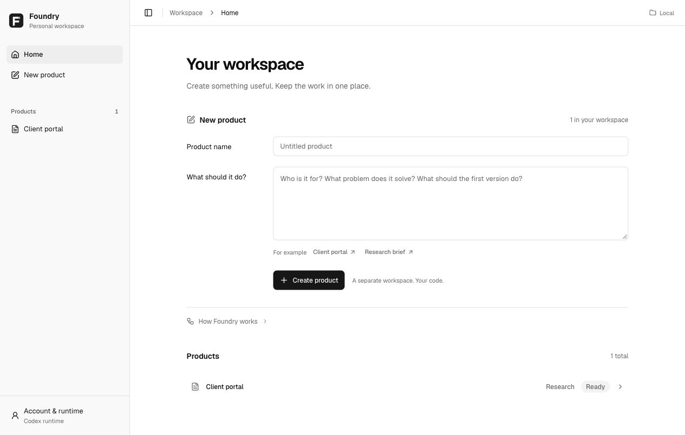
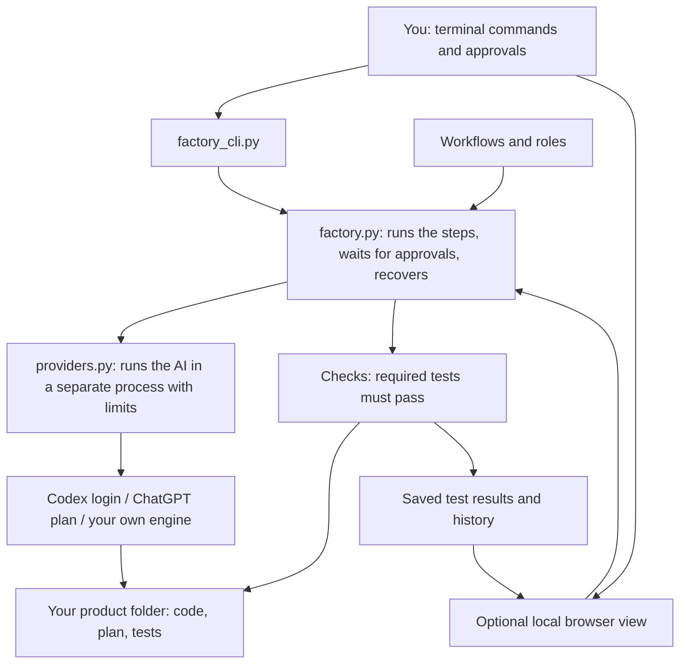

# Foundry

**Describe an idea. Your product files stay in the folder you choose. When you run a step, a cloud AI provider may receive its prompt and selected files.**

You stay in charge of the big decisions: you approve the plan and the design before
anything is built. Foundry only calls a product done when its real tests pass.



## Start

Install from source on macOS or Linux. Foundry is terminal-first; the browser
workspace is an optional local view:

```sh
git clone https://github.com/dabhiram13/foundry.git
cd foundry
./foundry --help
```

The first run sets up a Python environment. Create and run a product without
opening a browser:

```sh
codex login
./foundry new reading-list --idea "A local reading list with unread filtering."
./foundry configure reading-list --confirm-subscription
./foundry run reading-list
./foundry run reading-list
./foundry review reading-list
# Approve the exact revision printed by review:
./foundry approve reading-list --revision SHA256_FROM_REVIEW
```

`./foundry` and `./foundry --help` only print terminal help. Use
`./foundry ui` for the optional local browser view at `http://127.0.0.1:8765`.
You need Python 3.11+, Git, and the Codex CLI for AI work. Use Node.js 24 LTS
to rebuild the app, documentation site and TypeScript preview.
It runs on macOS and Linux. Signing in with ChatGPT currently needs the macOS
Keychain; the Codex login works wherever Codex does.

If you already have this checkout, run `./foundry` from it; no need to clone again.
You need access to the repository to clone it. There is no published package
installer. The old browser launch forms `./foundry --port`,
`./foundry --products-dir PATH` (without a terminal command) and
`./foundry --no-browser` remain for compatibility and are deprecated.

**[Start guide: installation, sign-in and your first product](docs/GETTING-STARTED.md)**
· **[Browse the docs](docs/README.md)**

1. Sign in with `codex login` using your ChatGPT subscription.
2. Use `./foundry new`, `configure`, `run`, `review` and `approve` to move
   through Research, Plan, Design, Build, Test and Ship. Plan and Design always
   require the owner's exact-revision approval; no command publishes a product.
3. Your product is in its own folder. Publishing, hosting, and connecting paid
   services are separate decisions you make yourself.

Products are saved under the sibling `products/` folder, each with its own code,
Git history, plan, settings, and test results. Use `--products-dir PATH` to save
them somewhere else on each terminal command. Use `./foundry ui --port 8766`
to select another browser port.

## The six steps

| Step | What happens | Who decides |
|---|---|---|
| Research | Who has this problem, what they use today, what is unknown | Foundry |
| Plan | Who it is for, what is in and out, how you will know it works | **You approve** |
| Design | Screens, steps, empty and error states, mobile layout | **You approve** |
| Build | Splits the plan into small tasks; builds, tests, and saves a Git checkpoint for each | Foundry |
| Test | Runs the product's tests and reports anything it could not check | Foundry |
| Ship | A short summary of what was built, tested, and still missing | You decide what happens next |

If the plan or design changes after you approve it, Foundry asks you again.

### How Build works

1. Foundry asks the AI for a short task list (3 to 8 tasks) and saves it to
   `docs/product/tasks.md`.
2. It builds **one task per turn**. After each task it runs the product's required
   checks.
3. If a check fails, Foundry sends the failing output back to the AI to fix, up to
   **3 tries**. If it still fails, Foundry stops and shows you which task failed.
   **Try again** picks up from that task.
4. Each finished task is saved as a Git commit (`Foundry build task 2: ...`) in the
   product's own repository, so you can see or undo any step.

The Build step on the product page lists the tasks and shows which one is running.

## How it works



The Python controller moves between steps and checks the results. The AI engine
does the actual work with its own tools. Foundry keeps going until it needs your
approval, something fails, you stop it, or the ship summary is ready. An AI saying
"done" is never enough: required checks must pass.

More detail: [architecture](docs/ARCHITECTURE.md),
[platform notes and plans](docs/FACTORY-PLAN.md).

### TypeScript migration

The default launcher, Python server and MCP still use the existing Python
controller. A strictly typed, per-workspace `factory` controller preview is
available through the installed Node project CLI; it does **not** replace the
public launcher, browser UI or MCP service, and it refuses to mutate Python-owned
workspaces. Plan and Design require exact-revision owner approvals; Test requires
a validated read-only review and Ship remains local with publication unauthorized.
The first Build task bootstraps required checks and an explicit approved-criterion
mapping; the installed journey is covered with a local fake provider, not a live
provider qualification.
See the [preview boundaries](docs/specs/typed-runtime-preview.md) and
[migration plan](docs/specs/typed-foundry.md). No migration or faster-performance
claim is implied by the language change. Products built with Foundry can use any
suitable language.

The [static documentation site](docs/DOCUMENTATION.md) adds searchable `/docs/`
pages without a project service or account. It is built from this repository's
Markdown; no public hosting is configured by these build commands.

## AI engines and roles

Codex is the built-in engine. Your Codex login runs through `codex exec`; Foundry
never reads or copies your credentials and never switches to paid API billing on
its own. Confirm the subscription login in product settings before the first run;
changing engines clears that confirmation. This is your confirmation, not a
runtime inspection of how your account is billed. On macOS it uses the Codex desktop app's executable; set `FOUNDRY_CODEX`
to use another one. The ChatGPT plan option uses the official sign-in flow and is
still experimental. See [ChatGPT setup](docs/CHATGPT.md).

You can add a reviewed local agent executable in `.foundry/providers.json`. It
must actually run tools, respect permissions, and report progress; a plain model
endpoint or API key is not an agent runtime. A custom product step needs a
tested local agent connection and local billing. The separate lower-level
provider API route is explicitly paid and never enabled by the product CLI. See
[providers](docs/PROVIDERS.md).

Foundry ships **28 roles** (for example planner, designer, backend, quality gate).
Each step uses a few of them:

| Step | Roles |
|---|---|
| Research | `market-researcher`, `trend-validator` |
| Plan | `planner`, `spec-critic` |
| Design | `designer`, `design-evaluator` |
| Build | `planner`, `backend`, `connector` |
| Test | `quality-gate`, `api-tester`, `flow-tester` |
| Ship | `complete` |

Leave models blank to use your defaults, or pick a model per role under
**Settings → Roles**. Review roles are assigned read-only work; the chosen runtime
is responsible for enforcing those permissions. Instructions alone are not a sandbox.
The ChatGPT plan option currently runs roles as instructions in one session; use
the Codex login if you want them to run as separate helpers. Each request lists
the relevant saved inputs, approved document revisions and installed role files.
Helper model preferences apply to native helpers, not separate ChatGPT sessions.

Foundry also includes **37 workflows** (such as `$foundry-design` and
`$foundry-verify`) and **67 optional reference guides**. Load only the ones that fit
the product. The [catalog](docs/CATALOG.md) lists them all.

## Use it as a Codex plugin

The optional Codex integration includes a local plugin manifest, MCP server and
panel. Its compatibility marketplace label is **Foundry private**; that label
does not make the open-source framework account-gated. Terminal use needs no
plugin installation.

1. Open this folder as a trusted project in the Codex desktop app and restart it.
2. Open **Plugins**, pick the **Foundry private** source, and install **Foundry**.
   Trust the local command when asked.
3. Start a new chat and open Foundry from the sidebar, or ask:
   "Open Foundry and help me plan a new product."

Or from the command line, in this folder:

```sh
codex plugin marketplace add "$PWD"
codex plugin add foundry@foundry-private
codex plugin list
```

The plugin keeps its own environment and products in the host's `PLUGIN_DATA`
folder, separate from `./foundry`. Approvals and account controls only work from
the panel, not from the chat model. Publishing to the public Plugins Directory
needs a hosted HTTPS server and a review; see the
[submission guide](https://developers.openai.com/plugins/deploy/submission).

## Add Foundry to an existing product

```sh
python3 scripts/marketcraft.py install /absolute/path/to/product
```

This copies the workflows and tools into the product and sets up Git if needed.
It does not change your code. Use `--update` to update; it stops if you edited a
managed file. Inside a product, the AI normally runs these for you:

```sh
python3 scripts/marketcraft.py status
python3 scripts/marketcraft.py start booking-flow --spec docs/specs/booking-flow.md
python3 scripts/marketcraft.py verify
python3 scripts/marketcraft.py complete
```

Real checks live in `.foundry/project.json`. `complete` only works when they pass.
See [runtime and recovery](docs/RUNTIME.md) and [customization](docs/CUSTOMIZATION.md).

## Optional hooks

`.codex/hooks.json` adds reminders at session start, a small recovery note before
the chat is compacted, a warning when you stop with work in progress, and guards
against a few destructive Git commands. Review them with `/hooks`. They help but
are not a security boundary. A secret scanner for commits is available with
`git config core.hooksPath .githooks`. See [hooks](docs/HOOKS.md).

## Check the framework

See [Contributing](CONTRIBUTING.md) for setup and pull requests, and
[Security and trust](SECURITY.md) for execution boundaries and reporting guidance.

```sh
.venv/bin/python -m unittest discover -s tests -v
npm run typecheck:runtime && npm run build:runtime && npm run test:runtime
npx tsc --noEmit && npm run build:panel
npm run build:site && npm run test:site
FOUNDRY_PYTHON=.venv/bin/python npm run test:docs-browser
FOUNDRY_PYTHON=.venv/bin/python node tests/factory_browser.cjs
FOUNDRY_PYTHON=.venv/bin/python node tests/studio_browser.cjs
python3 -m unittest discover -s tests/fixtures/web_app -v
python3 -m unittest discover -s tests/fixtures/saas_app -p test_evaluator.py -v
python3 scripts/evaluate_journey.py
python3 scripts/check_catalog.py
python3 scripts/security_scan.py --whole-tracked
```

The browser test needs Playwright and Chromium already installed (CI pins
Playwright 1.63.0). The test app uses fake AI responses, so passing tests show the
controller and UI work, not that a real AI run will succeed. See
[evaluation](docs/EVALUATION.md) and [what is and is not proven](docs/VALIDATION.md).

The app uses a dark [design system](docs/DESIGN-SYSTEM.md): near-black surfaces,
Inter type, soft-gray primary controls, neutral selection details and an original
Foundry wordmark. Lucide icons and the original specialist portraits remain.
The top bar keeps products, creation and account controls in reach. A stage
sidebar puts current work beside its documents; narrow screens stack the panes.
The landing walkthrough is labeled example content, not a live AI result.
Animate UI adaptations bring consistent press feedback, sliding tab highlights,
AI choice cards and consent controls, with a finite radial specialist intro.
Quiet motion respects your device and local
preference. [Integration details and component choices](docs/ANIMATE-UI.md).

## Old names

`marketcraft` and `product-foundry` still work, as do `scripts/marketcraft.py`,
`scripts/foundry.py`, `foundry-*` workflows, `.foundry`, `MARKETCRAFT_*` variables,
and `docs/project/marketcraft.json`. Nothing needs migrating.

[Provenance](docs/PROVENANCE.md) records the project's history;
[third-party notices](THIRD_PARTY_NOTICES.md) keep attribution and licenses.
