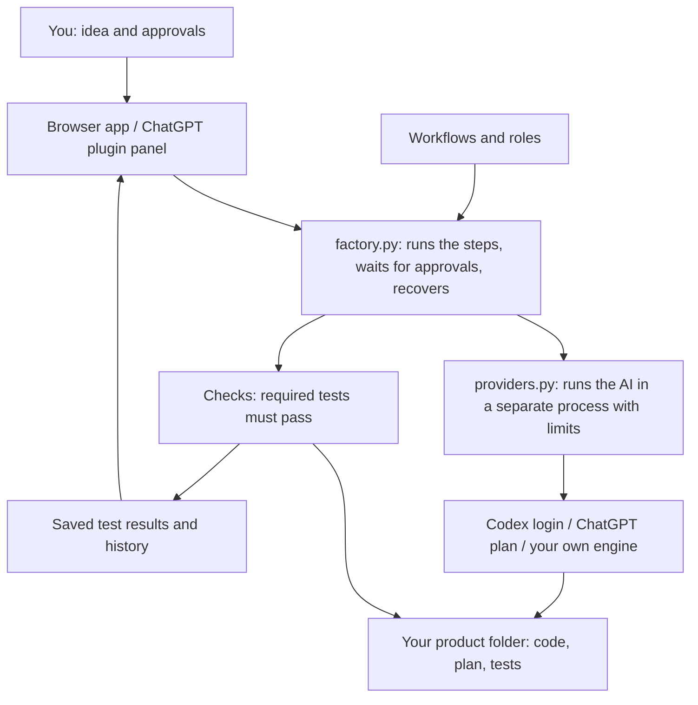

# Foundry

**Describe an idea. Foundry researches it, plans it with you, builds it, and tests it, all on your computer.**

You stay in charge of the big decisions: you approve the plan and the design before
anything is built. Foundry only calls a product done when its real tests pass.


## Start

```sh
./foundry
```

The first run sets up a Python environment and opens `http://127.0.0.1:8765`.
You need Python 3.11+, Git, and the Codex CLI. Rebuilding the app needs Node 22+.
It runs on macOS and Linux. Signing in with ChatGPT currently needs the macOS
Keychain; the Codex login works wherever Codex does.

1. Describe what you want to build, give it a name, and select **Create product**.
2. Pick the AI under **Account & AI**: your existing Codex login, or
   **Continue with ChatGPT** to use your ChatGPT plan.
3. Select **Start Research**. Foundry researches the idea and writes a plan.
4. Read the plan and select **Approve and continue**. Do the same for the design.
5. Foundry builds the product, runs its tests, and writes a ship summary.
   If a test fails, it stops and shows you why.
6. Your product is in its own folder. Publishing, hosting, and connecting paid
   services are separate decisions you make yourself.

Products are saved under the sibling `products/` folder, each with its own code,
Git history, plan, settings, and test results. Use `--products-dir PATH` to save
them somewhere else, and `--port 8766` to use another port.

## The six steps

| Step | What happens | Who decides |
|---|---|---|
| Research | Who has this problem, what they use today, what is unknown | Foundry |
| Plan | Who it is for, what is in and out, how you will know it works | **You approve** |
| Design | Screens, steps, empty and error states, mobile layout | **You approve** |
| Build | Splits the plan into small tasks; builds, tests, and saves a Git checkpoint for each | Foundry |
| Test | Runs the product's tests and reports anything it could not check | Foundry |
| Ship | A short summary of what was built, tested, and still missing | You publish |

If the plan or design changes after you approve it, Foundry asks you again.

### How Build works

1. Foundry asks the AI for a short task list (3 to 8 tasks) and saves it to
   `docs/product/tasks.md`.
2. It builds **one task per turn**. After each task it runs the product's required
   checks.
3. If a check fails, Foundry sends the failing output back to the AI to fix, up to
   **3 tries**. If it still fails, Foundry stops and shows you which task failed.
   **Try again** picks up from that task.
4. Each finished task is saved as a Git commit (`Foundry build task 2: ...`) in the
   product's own repository, so you can see or undo any step.

The Build step on the product page lists the tasks and shows which one is running.

## How it works



The Python controller moves between steps and checks the results. The AI engine
does the actual work with its own tools. Foundry keeps going until it needs your
approval, something fails, you stop it, or the ship summary is ready. An AI saying
"done" is never enough: required checks must pass.

More detail: [architecture](docs/ARCHITECTURE.md),
[platform notes and plans](docs/FACTORY-PLAN.md).

## AI engines and roles

Codex is the built-in engine. Your Codex login runs through `codex exec`; Foundry
never reads or copies your credentials and never switches to paid API billing on
its own. Confirm the subscription login in product settings before the first run;
changing engines clears that confirmation. This is your confirmation, not a
runtime inspection of how your account is billed. On macOS it uses the Codex desktop app's executable; set `FOUNDRY_CODEX`
to use another one. The ChatGPT plan option uses the official sign-in flow and is
still experimental. See [ChatGPT setup](docs/CHATGPT.md).

You can add your own engine in `.foundry/providers.json`. It needs to run tools,
respect permissions, and report progress; a plain model API is not enough. See
[providers](docs/PROVIDERS.md).

Foundry ships **28 roles** (for example planner, designer, backend, quality gate).
Each step uses a few of them:

| Step | Roles |
|---|---|
| Research | `market-researcher`, `trend-validator` |
| Plan | `planner`, `spec-critic` |
| Design | `designer`, `design-evaluator` |
| Build | `planner`, `backend`, `connector` |
| Test | `quality-gate`, `api-tester`, `flow-tester` |
| Ship | `complete` |

Leave models blank to use your defaults, or pick a model per role under
**Settings → Roles**. Review roles only read and report; they never change code.
The ChatGPT plan option currently runs roles as instructions in one session; use
the Codex login if you want them to run as separate helpers. Each request lists
the relevant saved inputs, approved document revisions and installed role files.
Helper model preferences apply to native helpers, not separate ChatGPT sessions.

Foundry also includes **37 workflows** (such as `$foundry-design` and
`$foundry-verify`) and **67 optional reference guides**. Load only the ones that fit
the product. The [catalog](docs/CATALOG.md) lists them all.

## Use it as a Codex plugin

This repository is also a private local plugin (`plugin.json`, `mcp.json`, an MCP
server, and a panel).

1. Open this folder as a trusted project in the Codex desktop app and restart it.
2. Open **Plugins**, pick the **Foundry private** source, and install **Foundry**.
   Trust the local command when asked.
3. Start a new chat and open Foundry from the sidebar, or ask:
   "Open Foundry and help me plan a new product."

Or from the command line, in this folder:

```sh
codex plugin marketplace add "$PWD"
codex plugin add foundry@foundry-private
codex plugin list
```

The plugin keeps its own environment and products in the host's `PLUGIN_DATA`
folder, separate from `./foundry`. Approvals and account controls only work from
the panel, not from the chat model. Publishing to the public Plugins Directory
needs a hosted HTTPS server and a review; see the
[submission guide](https://developers.openai.com/plugins/deploy/submission).

## Add Foundry to an existing product

```sh
python3 scripts/marketcraft.py install /absolute/path/to/product
```

This copies the workflows and tools into the product and sets up Git if needed.
It does not change your code. Use `--update` to update; it stops if you edited a
managed file. Inside a product, the AI normally runs these for you:

```sh
python3 scripts/marketcraft.py status
python3 scripts/marketcraft.py start booking-flow --spec docs/specs/booking-flow.md
python3 scripts/marketcraft.py verify
python3 scripts/marketcraft.py complete
```

Real checks live in `.foundry/project.json`. `complete` only works when they pass.
See [runtime and recovery](docs/RUNTIME.md) and [customization](docs/CUSTOMIZATION.md).

## Optional hooks

`.codex/hooks.json` adds reminders at session start, a small recovery note before
the chat is compacted, a warning when you stop with work in progress, and guards
against a few destructive Git commands. Review them with `/hooks`. They help but
are not a security boundary. A secret scanner for commits is available with
`git config core.hooksPath .githooks`. See [hooks](docs/HOOKS.md).

## Check the framework

```sh
.venv/bin/python -m unittest discover -s tests -v
npx tsc --noEmit && npm run build:panel
FOUNDRY_PYTHON=.venv/bin/python node tests/factory_browser.cjs
python3 -m unittest discover -s tests/fixtures/web_app -v
python3 -m unittest discover -s tests/fixtures/saas_app -p test_evaluator.py -v
python3 scripts/evaluate_journey.py
python3 scripts/check_catalog.py
python3 scripts/security_scan.py --whole-tracked
```

The browser test needs Playwright and Chromium already installed (CI pins
Playwright 1.63.0). The test app uses fake AI responses, so passing tests show the
controller and UI work, not that a real AI run will succeed. See
[evaluation](docs/EVALUATION.md) and [what is and is not proven](docs/VALIDATION.md).

The app uses the Soft studio [design system](docs/DESIGN-SYSTEM.md): a powder-blue
canvas, warm paper workbench, Manrope type, Phosphor icons and the original
specialist portraits. The top bar keeps products, creation and account controls
in reach. Work, Documents and Activity share one product desk.

## Old names

`marketcraft` and `product-foundry` still work, as do `scripts/marketcraft.py`,
`scripts/foundry.py`, `foundry-*` workflows, `.foundry`, `MARKETCRAFT_*` variables,
and `docs/project/marketcraft.json`. Nothing needs migrating.

[Provenance](docs/PROVENANCE.md) records the project's history;
[third-party notices](THIRD_PARTY_NOTICES.md) keep attribution and licenses.
