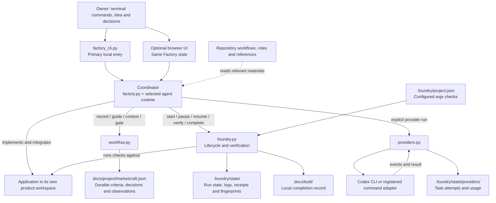
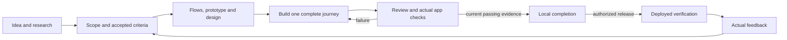
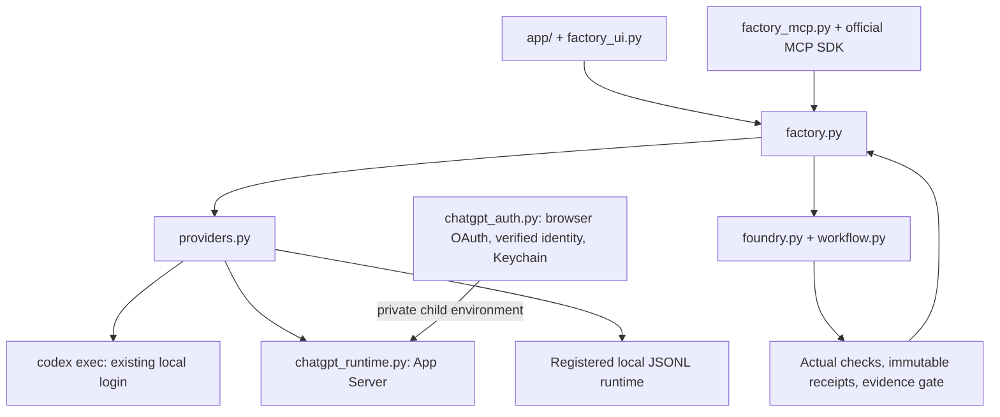

# Inside Foundry

Foundry's product direction is a **provider-independent software factory**: give it a product idea, settle meaningful decisions, choose an execution provider, and carry the work through design, implementation, verification, and release. The repository owns the process and materials; a provider supplies execution.

This document maps the current local factory and the reusable materials inherited from the `32d5a87` baseline. A separately installed global Foundry skill is optional convenience packaging. It is not the factory and is not required to use the repository.

## TypeScript migration status

The diagrams below describe the active Python controller. The parallel TypeScript
foundation in `src/core/`, `src/runtime/` and `src/cli/` is a contributor preview,
not a replacement for that controller. It adds validated contracts, a neutral
role catalog and an isolated project CLI. Python and TypeScript workspaces must
not be written by both runtimes; there is no automatic state migration yet.

Structured review validation is implemented as a contract, but is **not yet wired
into the active Factory Test/Ship steps**. Provider registration also remains
different from qualification. Those migrations must be completed and tested before
the launcher changes. See the [preview](specs/typed-runtime-preview.md) and
[full migration scope](specs/typed-foundry.md).

## 1. Materials already inside this repository

```mermaid
flowchart TB
    F["Foundry repository"]
    F --> W["Workflow and product contracts"]
    F --> M["Reusable building materials"]
    F --> X["Executable Python components"]
    F --> C["Current Codex integration"]

    W --> W1["docs/WORKFLOW.md<br/>Research → scope → design → build → verify → release → learn"]
    W --> W2["docs/WORKFLOW-CONTRACTS.md<br/>Criteria, evidence, decisions and handoffs"]
    W --> W3["docs/templates/<br/>Briefs, UX artifacts and record shapes"]

    M --> M1[".agents/skills/<br/>37 workflow instructions"]
    M --> M2[".foundry/workflows/<br/>6 deeper implementation recipes"]
    M --> M3["library/skills/<br/>67 optional references"]
    M --> M4[".foundry/philosophy/<br/>7 engineering principles"]
    M --> M5[".foundry/references/source-docs/<br/>101 supporting documents"]

    X --> X1["scripts/foundry.py<br/>Install, run state, checks and completion"]
    X --> X2["scripts/workflow.py<br/>Records, next-step guidance and evidence gates"]
    X --> X3["scripts/providers.py<br/>Execution adapters, budgets and cancellation"]
    X --> X4["scripts/qualification.py<br/>Local evaluation and explicit selection"]

    C --> C1[".codex/agents/<br/>28 specialist role configurations"]
    C --> C2[".codex/hooks.json + scripts/hooks.py<br/>Optional context and recovery hooks"]
    C --> C3["skills/* + scripts/connect_codex.py<br/>Optional global conversation shortcuts"]
```



The materials are concrete files, not 37 running services or 28 continuously active agents. The coordinator reads relevant instructions and chooses appropriate specialists. Inventory counts describe what is packaged, not what has been executed successfully for a product.

| Material | What it contributes | Actual source |
|---|---|---|
| Workflow instructions | Tasks such as discovery, specification, design, implementation, verification, repair, and release | [.agents/skills/](../.agents/skills/), for example [foundry-mvp-build](../.agents/skills/foundry-mvp-build/SKILL.md) |
| Deeper recipes | Authentication, billing, design system, landing page, legal, and onboarding instructions | [.foundry/workflows/](../.foundry/workflows/) |
| Principles | Scope, evidence, trust boundaries, async state, entitlement, data flow, and visual behavior | [.foundry/philosophy/](../.foundry/philosophy/) |
| Specialist roles | Research, planning, design, implementation, testing, security, and completion responsibilities | [.codex/agents/](../.codex/agents/), listed in [CATALOG.md](CATALOG.md) |
| Optional references | Stack-specific implementation knowledge to load when relevant | [library/skills/](../library/skills/) and [.foundry/references/source-docs/](../.foundry/references/source-docs/) |
| Record templates | Inputs for decisions, assumptions, criteria, observations, quality evidence, and handoffs | [docs/templates/](templates/) |

Several recipes and roles contain Next.js, Supabase, Stripe, oRPC, or other stack assumptions. These are conditional materials, not a requirement that every product use that stack. Markdown can be read by different agents, but that does not make its tool names, role format, or execution instructions automatically portable.

## 2. How the existing components work together

Solid arrows below represent explicit work or calls. Reading instructions does not automatically execute them.



The lower-level lifecycle and provider runner remain separate APIs. The new `factory.py` controller integrates them: stage artifacts, owner approvals, provider receipts, configured checks, workflow criteria, and local completion. The UI and MCP service use that same controller.

| Executable | Responsibility | Boundary |
|---|---|---|
| [foundry.py](../scripts/foundry.py) | Install/update managed files; maintain one active run; execute configured checks; fingerprint inputs; record completion | `start` does not generate an app. Completion is local evidence, not deployment or owner acceptance. |
| [marketcraft.py](../scripts/marketcraft.py) | Compatible CLI entry into the same runtime | Its name does not identify a second factory. |
| [workflow.py](../scripts/workflow.py) | Validate and append records; track freshness; recommend a next step; evaluate declared criteria | `guide` is advice. `gate` checks records and executes no work. Add the applicable gate to required project checks when it must block completion. |
| [providers.py](../scripts/providers.py) | Validate execution requests; launch an adapter; track attempts, output, budgets, cancellation, and recovery | The factory selects stage guidance and dispatches through this contract. Capability metadata alone is not proof that a provider implements it. |
| [qualification.py](../scripts/qualification.py) | Register artifacts, run local evaluators, and permit explicit selection against current qualified evidence | Optional side path; does not generate candidates, promote automatically, or deploy. |
| [hooks.py](../scripts/hooks.py) | Context recovery, checkpoints, and narrow optional local guards | Codex event integration; not the factory engine or a security boundary. |
| [test_runner.py](../scripts/test_runner.py), [evaluate_journey.py](../scripts/evaluate_journey.py) | Nonempty test reports and representative SaaS/browser evaluation | Framework fixtures do not prove a newly generated product. |
| [security_scan.py](../scripts/security_scan.py), [.githooks/pre-commit](../.githooks/pre-commit) | Scan tracked/staged content for known secret patterns | Pattern coverage, not a complete security audit. |
| [check_catalog.py](../scripts/check_catalog.py) | Check the packaged catalog and references | Packaging consistency, not execution quality. |

## 3. Product flow and evidence



The local factory executes research through the release handoff, stopping for owner scope/design reviews and failed checks. Deployed verification and customer feedback remain separate authorized work. The lower-level process in [WORKFLOW.md](WORKFLOW.md) also supports small fixes using only relevant stages. Decisions and observations go in the ledger; specs live in `docs/specs/`; application checks belong in `.foundry/project.json`.

Local completion checks the configured commands and freshness of their evidence. It does not independently know that every customer requirement has been covered. The coordinator must connect accepted criteria to real tests and, where needed, configure workflow gates as required checks. [The contract explains that wiring](WORKFLOW-CONTRACTS.md).

## 4. Provider independence: current implementation and missing pieces



| Layer | Current boundary |
|---|---|
| Factory coordination | Python owns durable stages, artifact checks, owner approval digests, dispatch, integration and recovery. |
| Local UI and plugin | Same controller through loopback HTTP or MCP. The bundled panel declares global and thread entrypoints. |
| Install/update and verification | Existing provider-neutral file, argv, receipt, freshness and record contracts. |
| Codex execution | Existing login through CLI; role files support explicit owner settings when the installed runtime supports them. |
| ChatGPT connection | Original standards-based OAuth code, verified JWKS identity, Keychain storage and a private App Server adapter. macOS credential backend only; plan-preview and App Server limitations apply. |
| Other providers | Strict registered JSONL processes can supply an agent runtime. No second live commercial provider has been qualified. |
| Specialist roles and hooks | Concrete Codex formats. The controller does not translate them into another provider's tools. ChatGPT plan preview disables native multi-agent. |
| Services and accounts | Connections already available to the selected runtime, with explicit permission. No separate universal OAuth broker or automatic paid-service provisioning. |
| Public hosting | Not implemented or published. Local plugin support does not make a laptop reachable from ChatGPT web. |

A product's own AI service is separate from the provider building that product.
A completed model turn verifies that request, not the application. See
[PROVIDERS.md](PROVIDERS.md), [CHATGPT.md](CHATGPT.md), and the live-flow checks in
[VALIDATION.md](VALIDATION.md).

## 5. Use the repository without a global Foundry skill

Run `./foundry --help`, create a product with `new`, and continue through
`run`, `review` and exact-revision `approve` commands. `./foundry ui` is an
optional browser view over the same Factory state. You can also open the
repository in a supported coding assistant and describe the product. The
coordinator can read the repository instructions directly, choose a separate
product folder, and invoke the installer. You do not need to install or invoke
`$foundry` first.

For an explicit local installation:

```sh
python3 scripts/marketcraft.py install /absolute/path/to/product
```

The [managed file list](../scripts/foundry.py) copies workflow materials, roles, references, selected docs, hooks, and Python scripts into the product and adds a managed instruction block. It preserves application code and initializes local Git if necessary. It does not scaffold the app, install its dependencies, connect a remote, or connect a provider account.

Open that product workspace and use its instructions for ongoing work. These commands inspect its state without invoking a model:

```sh
python3 scripts/marketcraft.py status
python3 scripts/marketcraft.py guide --request "Plan the first useful journey" --intent plan --complexity product
python3 scripts/marketcraft.py provider list
```

Then create the accepted spec, implement the actual app, configure its real checks, and use `start`, `verify`, and `complete` as documented in [RUNTIME.md](RUNTIME.md). Provider execution is an explicit additional call; `provider list` only lists registration metadata. Global conversation shortcuts under `skills/` are optional and are not copied by the product installer.

This architecture document belongs to the framework repository. Product installation copies the documents explicitly named by the installer, not every file under `docs/`.
