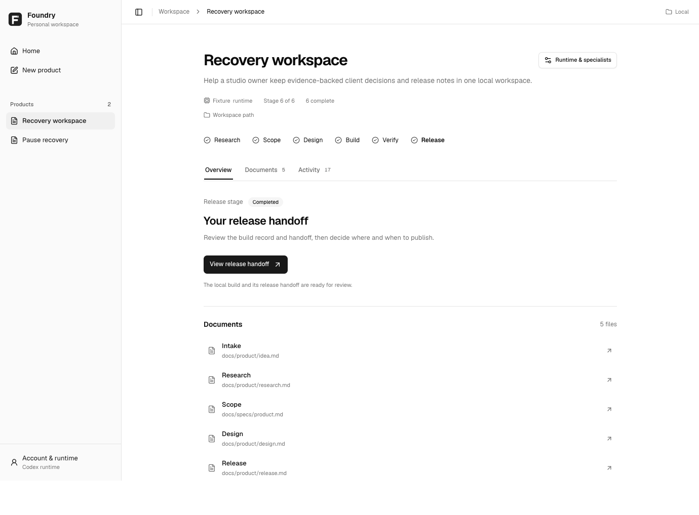

# Foundry workspace design

Foundry uses genuine [shadcn/ui](https://ui.shadcn.com/) components, React, and
Tailwind. The owner selected a Notion-like document workspace with shadcn controls.
The earlier Tabler direction is superseded and its dependency and assets removed.
No paid Figma assets are included. [The design system](DESIGN-SYSTEM.md) owns the
layout, tokens, typography, component rules, responsive behavior, and skill usage.
Dependency and asset licenses are retained in
[app/DEPENDENCY-NOTICES.md](../app/DEPENDENCY-NOTICES.md).

A quiet sidebar groups products. The centered page contains one idea composer or
one product's next step. Progress is a horizontal six-stage sequence; Documents
and Activity are tabs. Account, runtime, and specialist controls use accessible
Radix-backed shadcn dialogs. Review documents render as sanitized Markdown, with
approval tied to the exact scope/design bytes that the owner opened.

The monochrome vector mark at `app/assets/foundry-mark.svg` is the master logo.
Lucide React supplies SVG interface icons. Geist is bundled locally. The browser
and MCP panel run the same React application; the panel embeds its CSS, script,
font, mark, and tool bridge. There are no font, image, icon, or CSS CDN requests.

Edit `app/src/main.tsx` for composition and behavior, `app/src/workspace.css` for
product layout, and `app/src/globals.css` for semantic tokens. The owned shadcn
primitives are in `app/src/components/ui/`. Run `npm ci --ignore-scripts`,
`npx tsc --noEmit`, and `npm run build:panel`. Commit source and generated
`app/app.js`, `app/style.css`, and `app/panel.html` together.

The product above is a controlled test fixture, not a live AI-built release.

## What the checks establish

`tests/factory_browser.cjs` exercises creation, examples, navigation, account
controls with fake credentials, provider failure/retry/stop, owner review,
settings persistence/recovery, specialist overrides/inheritance, documents,
release handoff and the UI-to-MCP tool bridge. It uses real local Factory/Service
boundaries with a controlled provider. It checks desktop/tablet/mobile/480px,
keyboard/focus, reduced motion, overflow, script errors and content sanitization.
It does not prove live account access, AI product quality or public deployment.
The configured framework checks also exercise execution, security boundaries and
the separate sample SaaS journey. Generated screenshots are in output/playwright/.

## Comparison and next proof

As observed on 2026-10-02, [BuildThisNow's public page](https://www.buildthisnow.com/)
describes a Claude Code harness, workflows, specialist agents, hooks, multi-product
desktop management, and a prewired SaaS skeleton including authentication and
payments. These are vendor descriptions; the protected documentation was not
fully accessible in this research pass.

| Area | Foundry's current position |
|---|---|
| Ownership and runtime | Local controller, separate product repositories, no BuildThisNow installation/update service needed to execute it. Retained source notices still apply. |
| Product flow | Research, scope, design, build, verify and release handoff; owner scope/design reviews and saved stage records. |
| Verification and recovery | Digest-bound approval, real configured checks, freshness/evidence gates, cancellation and retry. Covered by framework and controlled browser tests. |
| Specialists | 28 role configurations, inherited coordinator defaults and explicit model/reasoning overrides. Roles are instructions; this is not evidence of 28 simultaneous workers. |
| Provider flexibility | Codex execution is supplied; custom adapter contract exists. ChatGPT plan path is experimental and a second commercial provider is not qualified end to end. |
| Ready-made SaaS services | No claim of a universal production skeleton with fully connected auth, billing, email and storage. Each product still needs its service setup and tests. |
| Distribution | Private local plugin and browser UI. Public hosted multi-tenant plugin deployment is separate work. |
| Product quality | Full control-flow checks are repeatable. A completed live AI-built product and owner acceptance remain necessary proof. |

Foundry is tailored to this owner's workflow, but overall superiority is not yet
established. The next useful benchmark is one real product built from a fixed
brief: score acceptance criteria, successful user journeys, setup effort,
recovery from one failure, and the ability to maintain the result. Add a reusable
service recipe only after that product demonstrates the need and integration.
