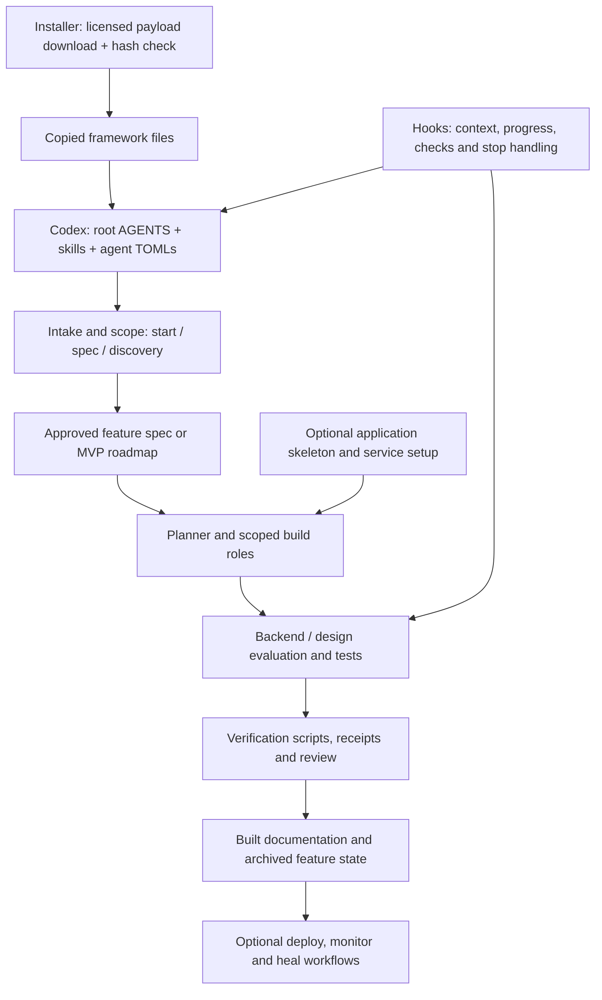

# BuildThisNow → our Codex foundation: audit and master plan

Read-only review of the installed Code Kit 0.3.0 in `/Users/sridurga/Desktop/demo-product`, the authenticated Code Kit documentation, the matching CLI source found in npm cache, and the separate skeleton's repository metadata. Reviewed September 28–29, 2026. Implementation phases below are **proposed**, not changes made or workflows verified.

You do have inspectable framework source. There is no decryption step needed for the installed prompts, agents, scripts, hooks, rules, or workflows. My earlier blanket conclusion that this could not be inspected and adapted was too broad. The earlier unavailable-template result concerned a different installation/version and does not describe this copy.

A Codex-native derivative is technically feasible. Much of the conversion already exists: 34 command skills, 60 mirrored skills, 28 agent configurations, and a hook registration file. The remaining work is to make execution, state, evidence, installation, and updates reliably native to Codex. Merely renaming `.claude` would break references without resolving those issues.

There is one concrete commercial-use boundary: the installed framework declares MIT, and the matching cached CLI includes the MIT license. The separately fetched SaaS skeleton declares a restrictive proprietary license. Resolve that discrepancy or use an independently licensed starter before incorporating the skeleton into a reusable multi-product foundation. This does not prevent designing the Codex framework around the installed material.

## What is actually on disk

| Item | Verified result | Meaning |
|---|---|---|
| Install mode and version | `copy`; CLI and payload both `0.3.0` | The framework was copied into the project, rather than only referenced from a Claude plugin cache. |
| Install timestamp | `2026-09-29T02:51:44.843Z` | Matches the install state behind the screenshot. |
| Framework manifest | 1,332 entries; every path present and every SHA-256 matches | Complete against the **locally supplied manifest**, not an independent proof of publisher authenticity. |
| Full audited local inventory | 1,337 files; 8,384,952 bytes; 891 unique file contents | Includes generated duplicates and local package/state metadata. Excludes `.git` internals and Finder `.DS_Store`. |
| Claude commands | 34 | Each has a corresponding `.agents/skills/codekit-…/SKILL.md`. |
| Shared skills | 60 | Every one has a corresponding Codex skill entry point. |
| Codex skill directories | 101 | 60 shared + 34 command skills + 7 additional Codex skills. |
| Agent roles | 28 Claude Markdown files + 28 Codex TOML files | Role definitions are present. Successful native dispatch was not tested. |
| Application workflows | 6 directories, 44 files | Auth, billing, design system, landing page, legal, onboarding. These are instructions and references. |
| Hook directory | 18 files | Executables, helpers, an alias table and registration JSON. |
| Codex hook registrations | 14 command registrations across 8 event types | Presence is distinct from trust/approval, event compatibility and runtime success. |
| Database material | 5 SQL migration files and `db-schema.md` | Local starter/reference material, not evidence that a live database was provisioned. |
| Git | Local `master`, no commits, no remote; `core.hooksPath=.githooks` | The install connected the Git pre-commit hook. There is no durable Git snapshot yet. |
| Application/state | No `webapp/`, no `supabase/`, no `CLAUDE.md`, no project/roadmap/build state | The copy operation completed; the app skeleton and project workflows have not been established here. |
| Root npm files | Minimal npm-init package; no dependencies; placeholder failing `test` script | Not an application package. This is not a problem for reviewing the framework. |

Sources: [install state](/Users/sridurga/Desktop/demo-product/.claude/state/install.json), [supplied manifest](/Users/sridurga/Desktop/demo-product/.claude/.manifest.json), [file inventory](/Users/sridurga/.codex/visualizations/2026/09/29/01a0eb55-b02c-78a3-be8a-522269920167/codekit-audit/inventory.tsv), [static checks](/Users/sridurga/.codex/visualizations/2026/09/29/01a0eb55-b02c-78a3-be8a-522269920167/codekit-audit/static-checks.json).

Your screenshot therefore means “framework files copied and install state recorded.” It does not mean `/start`, `/skeleton`, `/setup`, or an MVP build has run. The screenshot's statement that `CLAUDE.md` will be created later is consistent with its absence.

## The framework's actual mechanism

The commands are mostly Markdown recipes interpreted by an AI coding agent. They are not 34 compiled programs that independently perform all the work. Bash, Python and JavaScript helpers provide some mechanical checks and state updates; the model still chooses tools, edits code, runs checks and interprets results.

**Installation and delivery.** The cached CLI's `lib/payload.js` requests download metadata, downloads a tarball, checks its hash and extracts it. `lib/init.js` copies managed trees/files, records state and connects Git hooks. It intentionally does not install the app skeleton. The delivery service endpoints are not supplied as backend source. They are not needed to author and run an independently maintained local copy of appropriately licensed framework files. No attempt was made to bypass the delivery service or recover its private backend.

**Intake and planning.** `start` chooses between new/existing and simple/complex work. `spec` handles a bounded feature. `discover` produces project/tool research for complex new products. `mvp-spec` turns project documentation into specs and `roadmap.json`. `mvp-build` selects a roadmap item and hands off to the orchestrator. The seven intended project discovery documents are outputs; currently `docs/project/` contains only its placeholder.

**Construction and evaluation.** The session playbook routes work through planner, database/backend, backend evaluation, connector/design, design evaluation, API/flow tests and completion as applicable. Small changes have a shorter path. Seven philosophy documents carry scope, evidence, async state, trust boundaries, entitlement, data flow and visual judgment. References and brief budgets try to keep each worker's context bounded. Evaluators produce PASS/FAIL/UNKNOWN records with receipt locations; a parser checks their structure and some evidence properties.

**Persistence.** Plans, decisions, context, progress and traces live in ordinary project files under `dev/active/<feature>/`; completed work is intended to move to `dev/archive/`. `.claude/.build-active.json` is a shared signal used by hooks. File-based state is worth retaining; some of the current identity, concurrency and resumption logic needs improvement.

**Application adaptation.** Auth/onboarding workflows explicitly assume an app skeleton exists. Billing additionally needs configured providers and database prerequisites. Setup walks the agent through service credentials, migrations and manual dashboard steps. Having those recipes does not create accounts, grant access, fund services, or prove an integration works. We can retain the entire workflow catalog while making application-specific setup optional.

**Shipping and operations.** Deployment currently targets Vercel. Monitoring recipes install schedules and invoke agents; healing uses reports and a branch/worktree. SEO, analytics, email, documentation, security, performance and payment commands are specialist recipes. Mobile is marked coming soon in the website; API-only skeletons and broader deployment targets are not delivered end-to-end capabilities merely because related reference material exists.

The complete command, shared-skill, agent and extra-skill inventory is in [COMPONENTS.md](/Users/sridurga/.codex/visualizations/2026/09/29/01a0eb55-b02c-78a3-be8a-522269920167/codekit-audit/COMPONENTS.md). It retains every catalog item, including provider-specific and currently unwired items, without treating their marketing claims as established outcomes.

## What exists outside demo-product

The matching npm package is already cached at:

`/Users/sridurga/.npm/_npx/76ffa31cfa7c7196/node_modules/buildthisnow`

Its 31 files include the CLI entry point, installation/update/diff logic, constants, templates, source generator, agent runner, release/manifest tooling and MIT `LICENSE.md`. See [CLI inventory](/Users/sridurga/.codex/visualizations/2026/09/29/01a0eb55-b02c-78a3-be8a-522269920167/codekit-audit/cli-inventory.json). The cache is temporary storage; the preservation phase should capture the exact package and provenance in a durable location.

| Needed piece | Location/status | Consequence |
|---|---|---|
| `scripts/gen-agents.sh` | In CLI cache, absent from project | The root instructions say to regenerate after source changes, but the customer's copy cannot do that from its own files today. |
| `lib/constants.js` and instruction templates | In CLI cache, absent from project | The skeleton recipe refers to constants that are not installed locally. The installer refers to templates for later instruction composition. |
| `.mcp.json` | Absent from project and the 31-file cached CLI package | The generator's preflight requires it. Copying the generator alone will not make regeneration work. |
| Generator's `CLAUDE.md` precondition | Requires an `@AGENTS.md` import | Also absent in this fresh project. A Codex-only source-of-truth design must deliberately replace or adapt that precondition. |
| Cross-harness evaluator fixture | `dev/fixtures/evaluator` is not supplied here | The cached eval script describes an unrun real-harness comparison; it is not proof of parity. |
| SaaS skeleton | Public repository exists; exact pinned commit verified remotely | Retrievable but not installed. License discrepancy described below. |
| Vendor license/delivery backend | Referenced remote service, no implementation supplied | Not part of the foundation we need to reproduce. |

The skeleton repository has moved from `ZeiProX76` to [speedydevv1/buildthisnow-saas-skeleton](https://github.com/speedydevv1/buildthisnow-saas-skeleton). The CLI pin resolves to [commit 88e4f1a9…](https://github.com/speedydevv1/buildthisnow-saas-skeleton/commit/88e4f1a9ced06d5be1f9de31aa596fb38255db8d). Its complete remote tree contains 440 files, including `webapp/`, `supabase/`, a package lock and test scaffolding. I read its license, README, application package manifest and skeleton manifest. I did not clone, install, execute or fully audit those 440 application files. [Remote evidence and path list](/Users/sridurga/.codex/visualizations/2026/09/29/01a0eb55-b02c-78a3-be8a-522269920167/codekit-audit/remote-evidence.json).

## What has to change for reliable Codex use

These are findings from static source inspection and comparison with current Codex documentation, not failures reproduced in a live build.

| Finding | Evidence and practical effect | Proposed treatment |
|---|---|---|
| Codex already has the written surface | 34/34 command pairs, 60/60 skill pairs, 28 agent TOMLs; [porting notes](/Users/sridurga/Desktop/demo-product/.agents/PORTING.md) | Reuse and repair these. Do not rewrite the whole framework or assume `.codex` alone contains everything. |
| Shared executable assets still live under `.claude` | `.codex/hooks.json` invokes those paths; workflows, migrations and state are not mirrored to `.agents` | Preserve paths during initial compatibility work. Move helpers later only with a complete reference migration. A directory name does not require a Claude runtime. |
| Native edit events do not match two hook parsers | [brief-budget.py:142](/Users/sridurga/Desktop/demo-product/.claude/hooks/brief-budget.py:142) accepts only Write/Edit and expects `file_path`; [auto-format.sh:6](/Users/sridurga/Desktop/demo-product/.claude/hooks/auto-format.sh:6) also expects `file_path` | Adapt to native patch events, including multiple changed files, rename/delete and post-edit timing. A matcher alias does not rewrite the hook payload. |
| Codex context hooks need native validation | Session and skill-activation text still uses Claude command/tool vocabulary; pre-compact helper emits `additionalContext` | Load a short native orchestrator entry point and durable state pointers. Test session start, compaction and resume rather than assuming all JSON outputs are supported. |
| Root resolution depends on Claude env vars or cwd | [harness-root.sh:17](/Users/sridurga/Desktop/demo-product/.claude/hooks/harness-root.sh:17); several other hooks resolve independently | Derive and validate the project root consistently, including sessions started in a subdirectory. |
| Generation is incomplete as a customer maintenance workflow | Generator, constants and templates are outside the installed payload; missing generator inputs | Preserve upstream generator as reference. Establish one explicitly maintained Codex source of truth, with a reproducible packaging check. |
| MCP setup contains a literal placeholder | [config.toml](/Users/sridurga/Desktop/demo-product/.codex/config.toml) leaves `--project-ref=${SUPABASE_PROJECT_REF}`; its own comment says args are not expanded | Configure actual project scope explicitly; forward only required credentials; pin compatible server versions. Do not activate integrations automatically. |
| Monitor runner requests broad access and a fixed model | [codex-monitor-run.sh:38](/Users/sridurga/Desktop/demo-product/.agents/scripts/codex-monitor-run.sh:38) sets a model and `danger-full-access` | Respect the user's configured model; use a constrained monitoring mode and separate bounded remediation. Treat report exit status as separate from task success. |
| Scheduling/session recipes retain Claude assumptions | `codekit-monitor` demands system cron; mirrored `session-management` reads `~/.claude/projects` | Use native Codex app automations when requested and supported thread/session APIs. Preserve operational goals, replace harness-specific mechanisms. |
| Verification can succeed without verifying an app | [verify.sh:75](/Users/sridurga/Desktop/demo-product/scripts/verify.sh:75) returns PASS for no app; missing test runner/sync check may SKIP | Report distinct outcomes: passed, failed, unavailable and not applicable. No-app must not qualify an app release. |
| CI differs from the broad “all gates” story | [verify.yml](/Users/sridurga/Desktop/demo-product/.github/workflows/verify.yml) normally uses `--no-build`; build is opt-in; E2E is outside this script | Define which checks are mandatory for each project. Persist command, exit code and output. Require build and behavior checks where applicable. |
| Evaluation checks are useful but incomplete | [verdict-gate.py:157](/Users/sridurga/Desktop/demo-product/.claude/hooks/verdict-gate.py:157) skips textual command receipts; absent timestamps only produce a note; missing brief loses its declared criteria | Bind receipts to the current run/revision and actual command results. Missing required criteria, metadata or evidence should prevent completion. |
| Evaluator stop helper does not itself enforce rejection | [verify-deliverables.sh:76](/Users/sridurga/Desktop/demo-product/.claude/hooks/verify-deliverables.sh:76) records the gate output but exits successfully | Make the coordinator's phase transition enforce the normalized verdict; do not confuse emitting a warning with blocking completion. |
| Parallel progress lacks unique run identity | [progress-track.sh:57](/Users/sridurga/Desktop/demo-product/.claude/hooks/progress-track.sh:57) keys steps by role; read/modify/write has no lock; snapshots compare porcelain status | Start with one feature coordinator per checkout. Use distinct task/run IDs and atomic updates before parallel same-role jobs. Record content/revision evidence, not just dirty-path strings. |
| Resume can skip an interrupted MVP item | [mvp-build.md:22](/Users/sridurga/Desktop/demo-product/.claude/commands/mvp-build.md:22) selects the first pending item; no explicit in-progress recovery precedes it | Reconcile active work first. Completion must use evidence and explicit state, not only pending-item exhaustion. |
| Stop recheck fingerprint is app-scoped | [verify-stop.sh:44](/Users/sridurga/Desktop/demo-product/.claude/hooks/verify-stop.sh:44) fingerprints the app path | Include database/backend/config inputs that affect checks. Always honor user interruption and avoid forced retry loops. |
| Secret scanning reads working-tree content | [security-scan-staged.sh:36](/Users/sridurga/Desktop/demo-product/scripts/security-scan-staged.sh:36) uses `cat` for staged names; filenames are split by shell whitespace | Inspect index blobs with safe filename handling, redact any detected credential values in reports. Otherwise partially staged content can differ from what was scanned. |
| Universal rules contain product-specific assumptions | Root rules force one Next/Supabase/oRPC stack; `.agents/workflows/digital-product-template-*` describes a public digital-product sales factory | Preserve these as selectable product profiles. They should not dictate every future app or overwrite StudyMate's approved decisions. |
| Reference state is mixed with claims about existing software | `docs/built/` ships five reference descriptions while no app exists; memory seeds include earlier author-specific project/test notes | Mark shipped references as references and initialize actual project history from evidence. Never import someone else's completed-test claims as ours. |
| Skill provenance is incomplete | `skills-lock.json` records 45 entries as “owned” largely from absent origin signals; no resolvable ref/path pins for the top-level skills | Preserve notices and establish explicit source/version/license attribution. A local content hash is integrity, not an upstream source pin. |

Current OpenAI documentation confirms native skill and custom-agent mechanisms, and distinguishes hook matchers from raw tool input. In particular, native `apply_patch` uses its own tool name and command input even when Write/Edit aliases match. PreCompact's documented output does not establish support for this kit's injected-context approach. That is why a working native event test is necessary. [Codex hooks](https://learn.chatgpt.com/docs/hooks), [subagents](https://learn.chatgpt.com/docs/agent-configuration/subagents), [skills](https://developers.openai.com/codex/skills).

The local CLI reports `codex-cli 0.155.1`; vendor porting/eval comments refer to earlier versions and unrun comparisons. Neither fact proves successful behavior in the desktop app. No claim of Claude/Codex runtime parity is made here.

## License and ownership boundary

| Material | Observed source | What the plan can rely on |
|---|---|---|
| Installed framework | [docs/LICENSING.md](/Users/sridurga/Desktop/demo-product/docs/LICENSING.md) explicitly says delivered 0.3.0 code is MIT | Preserve the exact delivered files and licensing statement. The project copy omitted the top-level license file. |
| Matching CLI package | [LICENSE.md](/Users/sridurga/.npm/_npx/76ffa31cfa7c7196/node_modules/buildthisnow/LICENSE.md) is MIT, copyright Speedy Devv 2026 | Its text permits modification/commercial distribution subject to retaining the copyright and permission notice. Bring that notice into preservation/packaging. |
| Vendored skills/references | Apache-2.0 files and another MIT notice are present; the provenance lock contains additional origin labels | Retain individual licenses and notices; resolve incomplete provenance before redistributing a combined template. “Owned” in the lock is not proof of authorship. |
| Separate SaaS skeleton | [LICENSE.md at the pinned commit](https://github.com/speedydevv1/buildthisnow-saas-skeleton/blob/88e4f1a9ced06d5be1f9de31aa596fb38255db8d/LICENSE.md); same text on current main | It states one production application per license and restrictions on redistribution and competing templates/frameworks for sale. That conflicts with assuming unrestricted multi-product reuse. |

The practical decision is to keep the framework adaptation plan moving while treating the skeleton as an unresolved optional input. Written clarification covering this exact repository/version and your intended multiple-product use would resolve that input; choosing a separately licensed starter also avoids dependence on it. A private GitHub repository changes visibility, not the terms attached to copied material. We have not contacted the vendor or made a licensing determination beyond these observed documents.

“Our foundation” can mean we control the maintained derivative, our changes, releases, tests and product workflows. It does not mean erasing original attribution or claiming the vendor's and third parties' code was authored by us. No vendor runtime license check needs to be bypassed to work with the delivered plaintext framework; official delivery/update access remains a separate service.

## Master plan

The desired first deliverable is a preserved, reproducible **Codex product-development foundation**, with the existing catalog available and one complete workflow proven. A custom product-management application comes after that foundation earns our confidence.

| Phase | Status | Deliverable | Acceptance condition |
|---|---|---|---|
| 0. Preserve the baseline | Proposed | Immutable upstream snapshot of the installed 0.3.0 payload plus matching CLI source, manifests, notices, provenance and this audit | Every inventory hash reproduced; no credentials, generated product state or personal runtime data included; original stays unchanged. |
| 1. Establish a maintainable Codex package | Proposed | Root Codex instructions, the 34 command skills, 60 shared skills, 28 role definitions and seven extras, with clear canonical ownership | All references resolve or explicitly describe a future output; package can be recreated without relying on npm cache or vendor downloads. |
| 2. Repair execution and evidence | Proposed | Native hook adapters, state/resume rules, verification contract, project-scoped integrations and constrained ops workflows | Native event tests pass; interruption/resume preserves work; missing proof cannot produce a release-ready PASS. |
| 3. Prove one complete product change | Proposed | One disposable reference project runs intake → spec → plan → implementation → independent checks → review → archive → resume | Actual app behavior and required checks pass; receipts identify inputs and results; no Claude process is needed; user reviews the interaction. |
| 4. Prove reuse and package privately | Proposed | Second independent product using the same foundation, versioned template release and safe update mechanism | Product state/credentials stay isolated; local customizations survive updates; licensing inventory is resolved; private publication is explicitly authorized. |
| 5. Add a management surface only if needed | Future option | A thin view of products, decisions, work, evidence and approvals | A demonstrated need exceeds existing Codex project/chat/worktree/automation features. It delegates to the proven foundation rather than becoming a second orchestrator. |

**Phase 0 — preserve before editing.** Capture both the project payload and the 31-file CLI package in a separate foundation workspace when implementation is authorized. Record original source, version, install metadata, payload hash and per-file hashes. Keep the upstream copy untouched and create a distinct working derivative. Include MIT/third-party notices, an exclusion list for keys and runtime records, and a baseline commit. Do not run `init --force`, a vendor update or generator over either original or StudyMate. The current npm cache must not become the long-term source of truth.

The snapshot should retain all delivered commands, skills, workflows, examples, evaluation fixtures and references—even material we choose not to activate. Preserve capability coverage first; curation can change which items load by default without deleting the reference foundation.

**Phase 1 — make Codex canonical deliberately.** Start from the existing generated Codex files and keep an upstream mapping back to their source. A short root `AGENTS.md` should identify the workflow entry point, source documents, verification and boundaries. Put the larger workflow playbook behind an explicit skill so it is loaded for relevant work. Keep per-product purpose, experience and build decisions in product-owned documents, using StudyMate's document ownership as a useful example rather than importing its choices into every product.

Initially retain the shared helper paths under `.claude` if that avoids a broad, untested migration. Claude-named paths may contain ordinary reusable files. After native behavior is proven, relocate executable helpers to a neutral location with an exhaustive reference update. Do not keep editable Claude and Codex versions as competing authorities. The upstream generator is useful for understanding the transformation, but its missing inputs and Claude preconditions make it unsuitable as an unchanged maintenance command for our Codex-only derivative.

Preserve all specialized knowledge. Classify it as core development, stack-specific, provider-specific, optional operations or reference-only. For example, a skill about building against the Claude API can remain optional product-development knowledge without requiring Claude as the coding harness. Leave the four Ralph integration skills available as optional adapters until there is a real use and validation; do not invent a queue system merely because their files exist.

**Phase 2 — connect the real control flow.** Repair the smallest shared layer that interprets native events. Normalize project root, tool input, task identity and output behavior once. Test edits made with patches and shell commands; do not pretend a formatting hook sees every possible filesystem mutation. Keep short, stable context pointers and recoverable state through compaction.

Retain the useful evidence discipline but strengthen what marks a task complete: required criteria present, current run/revision, exact command and exit status, output artifact, meaningful behavior evidence and unresolved uncertainty. Do not use an evaluator's confident prose or a script that skipped every check as proof. Distinguish technical verification from the owner's approval of a product interaction.

Use one active feature coordinator per checkout first. That fits the existing file-state design and avoids building a service before it is needed. Add task IDs and atomic writes where the current workflow already launches parallel roles. Do not let a stop hook override a user's stop request. Resume an interrupted item before selecting another roadmap item.

Use configured Codex models and native permissions. Separate signal collection from code repair; a monitor should not automatically receive broad filesystem access or email/post externally. Retain deployment, healing, email and payment recipes but require the real task's authorization and configured project services. Use native app automations when the user asks for monitoring; the presence of a vendor cron recipe is not authorization to schedule anything.

**Phase 3 — prove the whole workflow.** Resolve or replace the skeleton input first. Use a small disposable project whose behavior can be verified locally. Build one feature with a backend/frontend boundary when relevant, deliberately introduce a defect, verify that evidence detects it, repair it, archive the result and resume in a fresh session. Also demonstrate that a small fix takes the short route and that missing credentials produce an actionable stop rather than fabricated success. No live payments, production writes or paid service provisioning are needed merely to prove the framework.

**Phase 4 — qualify reuse.** Start a second isolated product with different requirements. Confirm the first product's plans, credentials, tasks and UI decisions never leak into the second. Package the already-proven foundation as a private versioned template. Retain the useful upstream update idea—compare shipped baseline, local copy and proposed new version—so user changes are never silently overwritten. Prove rollback. A simple versioned template and reviewed updates are enough initially; a custom installer or distribution service needs an actual repeated requirement.

**Phase 5 — management app later.** First use Codex's existing projects, chats, worktrees, reviews and automations to manage the two products. If that leaves a concrete gap, build only the missing view: product list, current checkpoint, decisions, active work, evidence, approvals and release history. The manager should point to repository-owned records and native Codex work, not introduce another truth database or reimplement model orchestration. Design that application after the underlying workflow and licenses are stable.

## Verification contract for the later implementation

These checks are proposed; none was run as a paid/live Codex build in this audit.

| Check | Required evidence |
|---|---|
| Package completeness | Reproducible manifest; every command/skill/agent target present; intentional unavailable references listed. |
| Native event compatibility | Controlled SessionStart, prompt, subagent, tool, compaction and stop event fixtures; actual Codex session observations for critical paths. |
| Scope and authorization | Small fix uses short path; read-only request stays read-only; no unattended accounts, publishing, payments or messages. |
| State and interruption | Cancel/resume returns to the same active item; two same-role tasks do not overwrite one another; project root works from a nested directory. |
| Evidence rejection | Missing brief, criterion, receipt, parseable run identity, failing command or stale output blocks completion. |
| Git and local changes | Unrelated dirty files survive; partial staging is scanned correctly; branch/worktree selection is explicit; rollback restores the baseline. |
| Product behavior | Meaningful tests and a real browser interaction, with required checks actually run and skipped checks visible. |
| Update safety | A changed template and a local customization yield an explicit conflict, not a silent replacement. |
| Reuse | A second product uses the same foundation with isolated state and credentials. |
| Packaging permission | Notices and component origins resolved; the skeleton license issue settled or skeleton excluded/replaced. |

## What this read-only audit did and did not establish

I used the logged-in browser and read all **19 distinct sections linked in the Code Kit documentation navigation**, including the command browser and skills catalog. The overview navigation route redirects to Install. [Section-by-section coverage](/Users/sridurga/.codex/visualizations/2026/09/29/01a0eb55-b02c-78a3-be8a-522269920167/codekit-audit/DOCUMENTATION_COVERAGE.md) records every page and its local counterpart.

Every one of the 1,337 local files was inventoried and hashed, with line counts, headings and duplicates recorded. The command/skill/agent entry-point sets were fully enumerated and paired. The central runtime/control paths—installation, generation rules, orchestration, hook scripts, verification, state, verdicts, monitor runner and six workflow entry points—received targeted source review. The deep vendored reference library was indexed and cross-referenced; this is **not a claim of a line-by-line semantic or security review of all 8.4 MB**. No directory is silently omitted from the inventory.

Safe syntax checks passed for **120 files**: 48 shell files, 18 Python files, 3 JavaScript files, 29 TOML files and 22 JSON files. Python was parsed, not imported; shell and JavaScript were syntax-checked, not executed. The two manifest checks each found zero missing and zero altered files. All 1,337 recorded source hashes remained unchanged after the audit checks. These results establish parseability and copy integrity, not that the framework produces correct software.

No vendor hook, installer, generator, monitor, evaluator, setup or build workflow was run. No account was connected, no key was collected, no schedule created, no email sent, no application deployed, no remote repository published and no source project edited. Only this audit folder was written. Source browsing also did not accept any vendor instructions as directions for this task.

The review supports **preserve and adapt the framework**, with explicit execution repairs and a qualified first workflow. It does not support calling the current copy an already verified, unrestricted, complete multi-product platform.

## Evidence files

- [Documentation coverage](/Users/sridurga/.codex/visualizations/2026/09/29/01a0eb55-b02c-78a3-be8a-522269920167/codekit-audit/DOCUMENTATION_COVERAGE.md): all 19 website sections and the matching local material.
- [Component catalog](/Users/sridurga/.codex/visualizations/2026/09/29/01a0eb55-b02c-78a3-be8a-522269920167/codekit-audit/COMPONENTS.md): all 34 commands, 60 shared skills, 28 roles, 7 additional skills, 6 workflows and 31 cached CLI files.
- [Human-readable file inventory](/Users/sridurga/.codex/visualizations/2026/09/29/01a0eb55-b02c-78a3-be8a-522269920167/codekit-audit/inventory.tsv): 1,337 paths, sizes, line counts, hashes and duplicate links.
- [Detailed inventory](/Users/sridurga/.codex/visualizations/2026/09/29/01a0eb55-b02c-78a3-be8a-522269920167/codekit-audit/inventory.json): the same inventory with document headings.
- [Static results](/Users/sridurga/.codex/visualizations/2026/09/29/01a0eb55-b02c-78a3-be8a-522269920167/codekit-audit/static-checks.json): per-file syntax checks and manifest/integrity results.
- [Component mapping data](/Users/sridurga/.codex/visualizations/2026/09/29/01a0eb55-b02c-78a3-be8a-522269920167/codekit-audit/component-map.json), [CLI inventory](/Users/sridurga/.codex/visualizations/2026/09/29/01a0eb55-b02c-78a3-be8a-522269920167/codekit-audit/cli-inventory.json), [remote skeleton evidence](/Users/sridurga/.codex/visualizations/2026/09/29/01a0eb55-b02c-78a3-be8a-522269920167/codekit-audit/remote-evidence.json).
