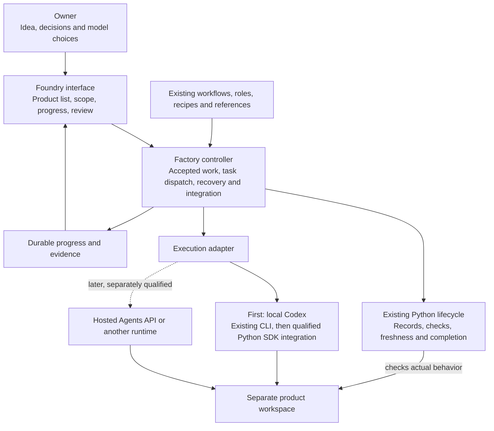

# Historical record: First usable release and plugin distribution

> Its UI and plugin plans are superseded by the terminal-first cutover.

Status: first local controller, UI, OAuth route and private MCP package implemented; live owner consent, native product qualification and public distribution have separate evidence requirements.
Research checked October 1, 2026 against official OpenAI documentation, the September 29 DevDay roundup, and Foundry `32d5a87`. The release source and documented boundaries are delivered together in the private repository.

## Recommendation

Deliver a **Codex-first software factory for the owner**, with a small plugin interface and an execution boundary that can later support another provider. Keep the existing Python core. Reuse Codex's working agent harness instead of building another model/tool loop. Foundry should own the product intent, accepted criteria, task assignments, progress, verification, and release evidence.

The global `$foundry` shortcut is optional. Installing a shortcut is not a release milestone. The useful milestone is: give Foundry a name and idea, settle scope, see a working product, interrupt/resume it, and verify the actual result.

The supported local entry is now `./foundry --help` and the terminal
`new`/`configure`/`run`/`review`/`approve` flow. `./foundry ui` remains an
optional browser view over the same Factory state; legacy browser flags are
compatibility forms, not the primary workflow.

## Implemented local architecture

The local controller and panel now exist. The hosted adapter remains a future path; the OAuth route uses the documented experimental App Server boundary. See the current README for exact setup and capabilities.

An MCP service exposes bounded factory operations to the plugin. It does not expose an unrestricted command runner. The UI presents the same state used by the CLI; it does not maintain a separate workflow. Initially, product work remains local. A remote plugin cannot acquire access to a laptop directory just because its server is registered.

## What the platform releases enable

### Plugin Extensions: a real interface for Foundry

Extensions can give Foundry a sidebar project view, a conversation panel, settings, onboarding, and artifact links. That fits an owner interface for starting/resuming work and reviewing results. These surfaces call the factory through MCP. Composer mentions are desktop-only; surface availability still varies. [Official Extensions guide](https://developers.openai.com/plugins/build/extensions).

Start with project selection, current stage, unresolved decisions, checks, and model settings. Add editors or specialized file handlers only when a product needs them. All proposed UI controls must correspond to implemented factory actions.

### Execution: use the existing harness

Use the current `scripts/providers.py` Codex CLI adapter to prove the first factory path. The official **Python Codex SDK is stable**, works with a pinned runtime, and is a suitable next integration for programmatic threads and continuation. Keep that upgrade behind the existing execution boundary and run the same contract checks before adopting it. [Codex SDK](https://learn.chatgpt.com/docs/codex-sdk).

Direct App Server integration exposes richer client behavior, but its documentation labels the command and WebSocket transport experimental and unsupported for production workloads. The implemented local ChatGPT route uses stdio and disables WebSocket Responses transport; it remains an experimental, privately qualified route. The desktop-bundled CLI inspected for this release is `0.159.2`; an owner override can choose another runtime. Keep this integration out of production claims until its live boundaries are exercised. [App Server](https://learn.chatgpt.com/docs/app-server).

The newer **Agents API** provides a managed Codex harness for hosted execution. It is a separate, API-billed route, including applicable tool/container charges. Consider it when hosted execution is required. An OpenAI-hosted environment can work while the owner's machine is offline once the required repository/files are available there; a self-hosted environment still needs its executor and infrastructure online. It is not an assumption that ChatGPT subscription usage pays for hosted factory jobs. [Agents API](https://developers.openai.com/api/docs/guides/agents-api/overview).

### Models and specialist agents

Allow one inherited project default and explicit per-role model/reasoning overrides. Avoid a permanent hardcoded GPT-6 list. On the initial CLI/SDK route, inherit the configured model or accept an owner-supplied choice and report runtime rejection clearly. Add a catalog-based picker only when the selected adapter exposes a qualified discovery interface; the stable SDK guide does not document a model-catalog API. Examples to evaluate are `gpt-6.1-sol` for general building, `gpt-6-astra` for difficult work, and `gpt-6-luna` for narrow repeatable tasks. Keep the owner's actual default until they choose otherwise. Model availability depends on the client, account, workspace, and execution route. [Current models](https://learn.chatgpt.com/docs/models).

Codex already supports `model` and `model_reasoning_effort` in project-local custom agent TOML. Role-file settings take precedence; absent overrides inherit through the documented resolution order. Foundry needs one understandable settings interface that resolves these choices without requiring manual edits to 28 files. Show requested model/effort settings before work. Validate against supported combinations when the adapter exposes that information; otherwise surface runtime rejection without substitution. Record requested and resolved settings separately; unknown resolved values remain unknown. [Custom agents](https://learn.chatgpt.com/docs/agent-configuration/subagents#custom-agents).

Use only relevant specialists, with separate write ownership and a concurrency limit. A model choice must not change permissions, enable a paid route, or silently choose another provider. Model discovery is not universal proof of entitlement: under the documented SIWC App Server setup, `model/list` may return a bundled catalog; an authorized successful turn establishes access for that request. [SIWC App Server](https://developers.openai.com/siwc/token-sharing-open-source/codex-app-server).

### Sign in with ChatGPT: useful, with a separate eligibility decision

Identity sign-in and permission to use a ChatGPT plan are different grants. The current docs describe commercial sign-in as a selected-partner trial, and plan usage for open-source partners and selected private clients. An eligible Plus/Pro account alone does not approve Foundry's integration. [SIWC quickstart](https://developers.openai.com/siwc/quickstart).

The open-source/local route has a documented OAuth integration. Paid or remotely hosted apps are directed to the interest process. Keep the repository private unless the owner decides otherwise; do not change licensing or visibility to force eligibility. Your first local release can use the supported Codex login flow without adding a new Foundry OAuth system. [Open-source/local plan usage](https://developers.openai.com/siwc/token-sharing-open-source).

The local SIWC bridge now implements consent, macOS Keychain protection, JWT verification, refresh and revocation. Preview limits reject Responses `multi_agent`, hosted MCP, native computer use, and several other API features on this route. Foundry disables native multi-agent execution on its ChatGPT plan route; the existing Codex route remains available for native specialist delegation. Treat these as different execution contracts. [SIWC preview limits](https://developers.openai.com/siwc/token-sharing-open-source/preview-limitations).

## Implementation order and release evidence

| Milestone | Concrete work | Required proof |
|---|---|---|
| 1. Stabilize the base | Repair interrupted-update permission preservation, unrelated stale-guide diversion, and macOS fixture path handling. Stop optional global-entry conflicts from blocking any chosen convenience setup. | Reproductions fail before each relevant fix and pass after; existing behavior remains covered. |
| 2. Complete one factory path | Add accepted-work dispatch, bounded provider execution, result integration, interruption/resume, and final verification using the existing lifecycle/record interfaces. Surface decisions that need the owner. | A real small product is implemented from an accepted spec, its test failure is repaired, and a restart resumes the same work without duplicate actions. |
| 3. Make model choices usable | Inherited project default, explicit per-specialist model/effort overrides, capability checks, concurrency and usage limits; catalog-based choices only on a qualified discovery route. | Selected role settings reach the actual runtime; unavailable choices fail clearly; no silent model or billing substitution. |
| 4. Package the owner release | Versioned local/repo plugin package; narrow MCP tools where needed; setup diagnostics and a small product/status/review interface on a supported host. | Fresh install, upgrade, start, cancel, resume, and uninstall preserve product files. The owner can use it without a global shortcut skill or editing paths/config files manually. |
| 5. Qualify with the owner's product | Run the chosen product through the full path, inspect the UI, test persistence and relevant failures, and record the result. | Owner can complete the intended journey. Framework fixtures and a model's success message cannot substitute for this. |
| 6. Prepare wider distribution | Decide local/team distribution versus a hosted public plugin. Prepare hosting, account isolation, publication metadata and review evidence for that selected channel. | Repeatable installation by another user; permission boundaries and product isolation exercised; publish the reviewed version only. |

Milestones 2–4 should grow as one thin working slice, not three large disconnected subsystems. Start by reusing `foundry.py`, `workflow.py`, and `providers.py`; add a factory module only for the missing integration. Preserve existing records and compatibility names. The UI follows the functioning path.

No owner release is complete until the real run has shown creation, repair, interruption, resumption, verification, and understandable failure handling. Deployment needs its own target and post-deployment check. Public release is a later result, not implied by a local pass.

## Distribution choices

For the first owner release, use a local or Git-backed repo marketplace on a supported client. A plugin can package skills and MCP integrations together; the MCP server implements and exposes its tools. Do not assume plugin packaging automatically discovers the existing `.codex/agents` directory: role installation/loading must be exercised in the selected runtime. Local hooks require trust and available scripts. [Packaging and local marketplaces](https://developers.openai.com/plugins/build/plugins).

For a public plugin, the current documented MCP route expects a public HTTPS service. Submission permits one connected MCP server, requires developer verification and review evidence, and currently rejects ZIPs containing lifecycle hooks or app references. A public package therefore needs a different release payload from a local package with hooks. Include MCP from the initial public submission if the factory needs it; adding MCP later to a published skills-only plugin is not supported. [Submission guide](https://developers.openai.com/plugins/deploy/submission).

Prepare a test account where needed, five positive and three negative review cases, a walkthrough, release notes, and publisher metadata plus the required HTTPS website, support, privacy-policy, and terms-of-service URLs. Verify redistribution rights for bundled materials before broad distribution. Publication approval is external; a valid package does not guarantee directory acceptance. Keep private project data, credentials, and runtime state out of release archives.

## Improvements worth doing

- **Reliable completion:** bind agreed criteria to real tests, current evidence, and explicit release outcomes. A successful agent turn is insufficient.
- **Recovery:** preserve task identity across failures and cancellation; prevent replay from duplicating edits or external effects.
- **Less instruction noise:** keep portable role purposes separate from stack-specific recipes; load only relevant references. Short, precise skill routing is more useful than activating the whole catalog. This follows the [current OpenAI guidance on skills and prompts](https://developers.openai.com/blog/rethinking-skills-and-prompts-for-gpt-6-astra).
- **Useful evaluations:** add regressions from actual product failures, compare candidate changes against the same tasks, and promote improvements deliberately.
- **A narrow provider boundary:** keep Foundry's goal, records, task descriptions, and evidence portable. Qualify a second execution adapter on the same end-to-end task before describing the whole factory as provider-independent.

Python remains suitable for the core and official Python SDK integration. Use TypeScript only where the plugin UI benefits from browser tooling. A rewrite, a fleet of always-running agents, and automatic model routing are not prerequisites for the first useful release.

## DevDay coverage and adoption decisions

The full [September 29, 2026 roundup](https://learn.chatgpt.com/docs/whats-new/devday-2026) was reviewed. The priorities below are Foundry recommendations, not OpenAI requirements.

| Announcement | Foundry decision |
|---|---|
| Dots | Later; ongoing maintenance requires an actual need. |
| Cross-device Work | Use host capability; avoid recreating sync. |
| ChatGPT Space | Optional collaboration destination. |
| Codex Astra Ultrafast | Optional eligible-account choice, never a requirement. |
| Reusable cloud environments | Evaluate for reproducible later cloud trials. |
| Security Cloud | Optional review integration. |
| Sign in with ChatGPT | Evaluate eligibility separately. |
| Sites with connected data | Optional future frontend route. |
| Plugin Extensions | Preferred host UI experiment. |
| MCP Events | Later, for requested feedback/CI triggers. |
| Website annotations | Useful future review input. |
| GPT-6.1 Sol | Candidate default, subject to owner choice. |
| API Astra Ultrafast | Optional API cost/latency tradeoff. |
| Slack and Teams | Later distribution/integration. |
| Team Tasks | Later team operations. |
| Workspace connections | Later organization setup. |
| Agent Security | Respect host/workspace policy. |

MCP Events specifically needs MCP 2.0 and the supported cloud/Work surfaces; it is not a universal local event loop. Use it only after a concrete user-requested monitoring flow exists. [MCP Events](https://developers.openai.com/plugins/build/mcp-events).

The [September API changelog](https://developers.openai.com/api/docs/changelog) was also checked: Agents API, GPT-6 Sol/Luna, model image fixes, cache diagnostics, live voice, image generation, and key-governance changes are relevant platform context. Hosted browser tools may help later evaluation; voice/image features are optional product capabilities. These do not replace product-specific verification or live account qualification.

## Current completion boundary

The local implementation includes the factory controller, browser UI, per-specialist
settings, original OAuth/Keychain sign-in, ChatGPT App Server execution adapter,
private MCP/plugin manifest and embedded panel. Runnable checks cover controlled
provider execution, HTTP trust boundaries, real lifecycle/evidence gates, recovery,
and the desktop/mobile UI flow. These are separate from live owner OAuth consent,
an actual account-backed generated product, native host plugin installation, and
public hosting/review. The accompanying validation document records their status.
